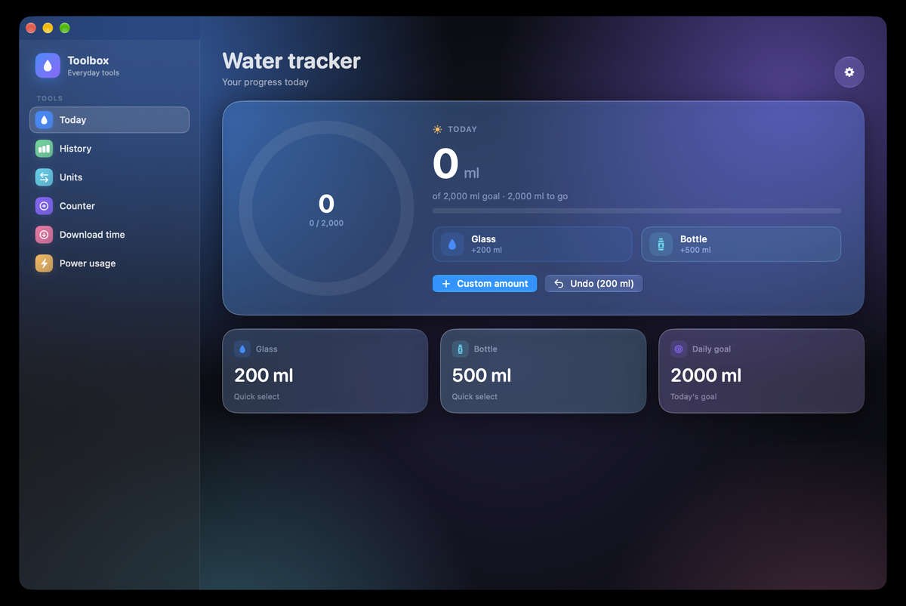
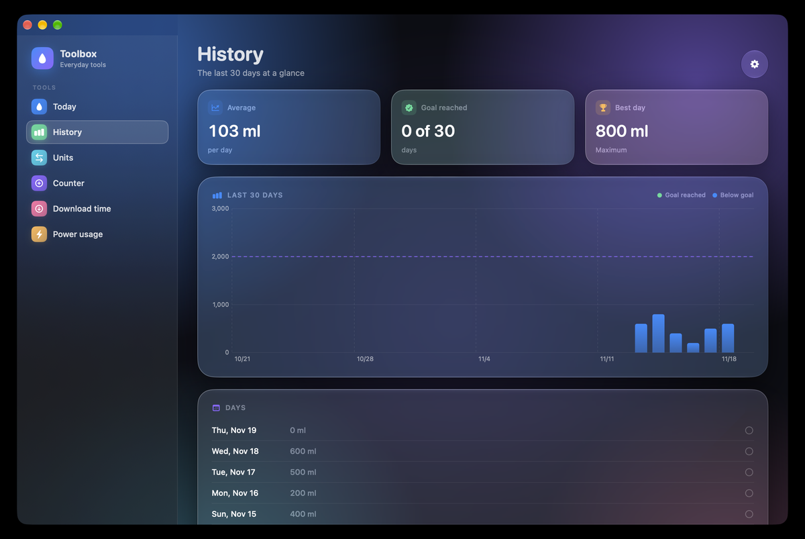
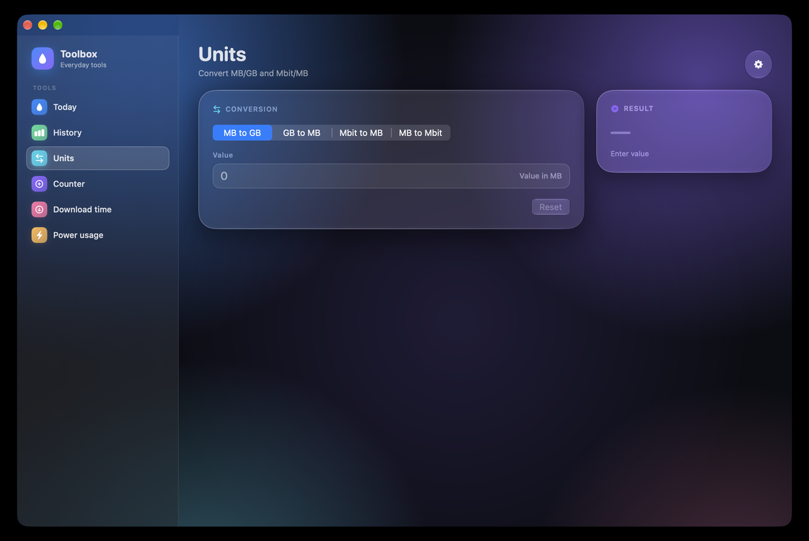
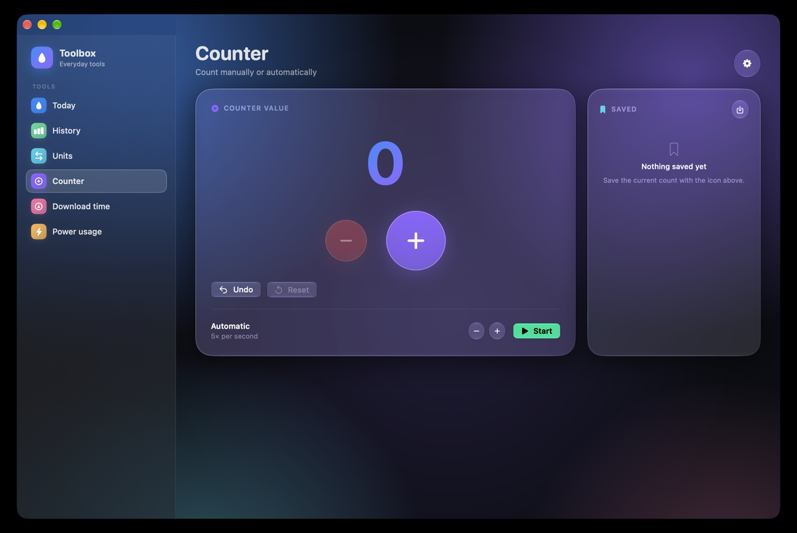
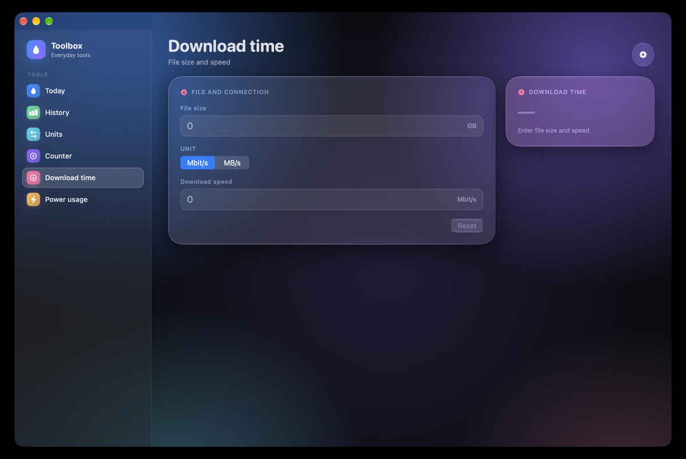
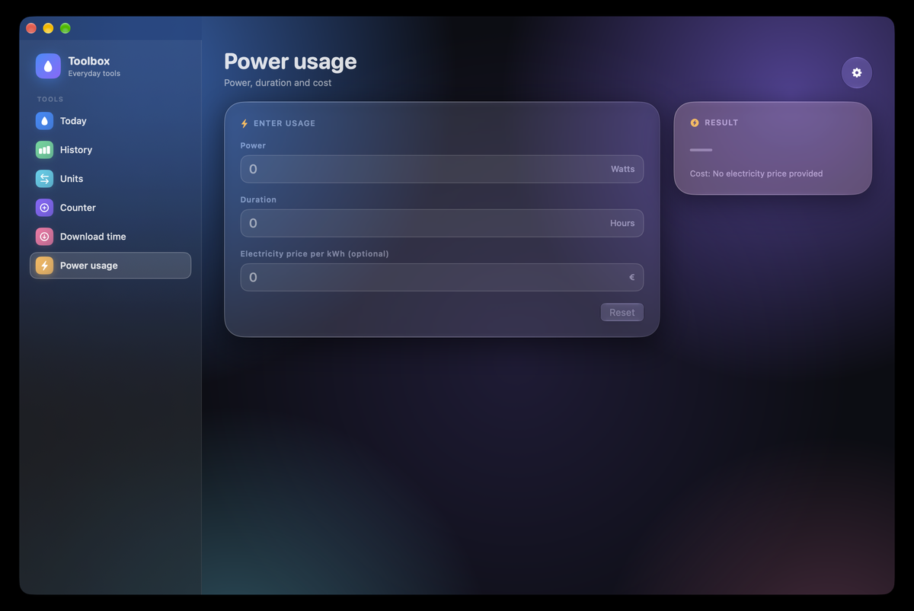

# Toolbox

A small collection of everyday tools as a SwiftUI app for iPhone, iPad, Mac and Vision Pro – including a Home Screen widget and Siri shortcuts. The same six tools are available as a desktop app for Windows, with syncing over the local Wi-Fi network across Mac, iPhone and PC.

## Screenshots

The screenshots show the English interface; German, Spanish and French are available as well.

<p align="center">
  
  
  
</p>
<p align="center">
  
  
  
</p>

## Download

### macOS

The ready-built Mac app is available as a DMG straight from GitHub:

[**Download Toolbox.dmg**](https://github.com/NHoart/Toolbox/releases/latest/download/Toolbox.dmg)

All versions are listed on the [releases page](https://github.com/NHoart/Toolbox/releases). After downloading, open the DMG, drag `Toolbox` into the **Applications** folder and launch the app with a right-click → **Open**. The DMG is not signed with an Apple Developer certificate and not notarized, which is why macOS blocks the very first launch.

The Mac app checks GitHub at most once a day at launch for a newer version. If the app lives in **Applications**, it downloads the new DMG, verifies the checksum and signature and replaces itself; when launched from Xcode or from the DMG it offers the download instead. Manually, use **Toolbox → Check for Updates…** or the button in Settings; the automatic check can be disabled there as well.

### iPhone and iPad

There is no ready-built IPA in the release and no App Store download for iPhone and iPad – the iOS app is built from source onto the device with Xcode. You need a Mac with Xcode 27.2 or newer and an iPhone or iPad with iOS/iPadOS 27.2 or newer.

1. Clone the repository and add your team ID to `Config/Local.xcconfig` – the command is shown in [Build and run](#build-and-run), and the team ID is listed in Xcode under **Settings → Accounts** next to the signed-in Apple account. The App Group below requires a paid developer team.
2. Open `Toolbox.xcodeproj`, select the `Toolbox` scheme and choose the iPhone or iPad connected by cable or Wi-Fi as the destination.
3. Enable Developer Mode on the device: **Settings → Privacy & Security → Developer Mode**, restart the iPhone and confirm the mode after unlocking. Without it, the app will not launch.
4. Press **Run** (⌘R). On first launch, iOS asks for **Local Network** access – allow it, otherwise the Wi-Fi sync cannot find other devices.
5. If iOS reports that the developer is not verified, open **Settings → General → VPN & Device Management**, select **Apple Development: …** and choose **Trust**.

For the widget and the data shared between app and widget, the App Group `group.com.noahsapps.Wassertracker` must be enabled in both targets under **Signing & Capabilities**; without it the debug build stops at the first access to the water tracker. With a free Apple account the installed app also runs for only seven days, after which you have to press **Run** in Xcode again. A new version does not reach the device automatically: run `git pull` and install again from Xcode.

### Windows

The Windows app is available as an installer straight from GitHub:

[**Download Toolbox-Setup.exe**](https://github.com/NHoart/Toolbox/releases/latest/download/Toolbox-Setup.exe)

Windows 10/11 (64-bit). Run the installer after downloading; it installs into the user profile without administrator rights. The installer is not signed, so SmartScreen may warn on the first launch – **More info → Run anyway** starts the app regardless.

The Microsoft Store version is an additional installation path and does not replace the installer. It has been available in the Microsoft Store since 17 November 2026, currently at version 3.6.0:

[**Toolbox for Windows in the Microsoft Store**](https://apps.microsoft.com/detail/9P4FPTHZHVJD)

The Store version updates through the Microsoft Store and trails the GitHub release; the newest GitHub release is available first as DMG and EXE. Setup and submission are described in [`windows/store`](windows/store/README.md).

The Windows app checks GitHub at most once a day at launch for a newer version. When installed, it downloads the new installer, verifies the SHA-512 checksum published in the release and installs the update in the background; afterwards it restarts. Manually, use **Settings → Updates**; the automatic check can be disabled there as well. The Microsoft Store version updates through the Store; the GitHub update check is disabled there.

## Features

The app is split into tabs:

| Tab | Description |
| --- | --- |
| **Today** | Water tracker: progress ring, quick pick for glass and bottle, custom amount (1–10,000 ml) and “Undo” for the last entry. |
| **History** | Chart of the last 30 days (Charts) with the daily goal, average, number of goals reached and the best day. |
| **Units** | Conversion between MB/GB and Mbit/MB. |
| **Counter** | Manual counter with plus/minus, undo, reset, auto-count mode (1–100 steps per second), haptic and sound feedback plus named, saved counter values in a sidebar. |
| **Download time** | Estimated download duration from file size and speed (Mbit/s or MB/s). |
| **Power usage** | Energy consumption from power × duration, optionally with cost calculation at your own kWh price. |

The Windows app contains the same six tools. The widget and Siri shortcuts exist only in the Apple version.

### Languages

All three platforms follow the system language and fall back to **English** when the system language is not available. German, English, Spanish and French are fully translated:

- **macOS, iOS, iPadOS, visionOS:** `Localizable.xcstrings` (String Catalog) in `Toolbox` and `ToolboxWidget`; English is the development language, so any unsupported system language resolves to English.
- **Windows:** `windows/renderer/i18n.js` picks the first supported entry from the system language list and uses the full region tag for number, date and currency formatting. A language can also be chosen manually in Settings; **System language** follows Windows.

Dates, numbers and currencies are formatted with the user's locale, so `en-GB` shows British formatting while the interface stays English.

The fallback is checked on the real built bundles, not only by a green build:

```bash
bash scripts/test-apple-localization.sh
```

The script builds the macOS and iOS app including the widget, runs a probe as each bundle's main executable with a forced `-AppleLanguages` value and checks every String Catalog key. It covers English, German, Austrian German, Spanish, French and unsupported languages (Italian, Japanese, Russian, Portuguese, Chinese), plus a deliberately removed German key that must fall back to English.

### Widget

The widget shows the daily progress as a ring (small and medium). In the medium size, glass and bottle can be logged with a single tap without opening the app. The timeline refreshes at least every 30 minutes and at midnight so the daily counter resets.

### Siri & Shortcuts

The “Log water” shortcut supports glasses and bottles (single, double or triple) and answers with the current total, for example:

> “Hey Siri, log two glasses of water in Toolbox”

The size of the glass and bottle comes from the app's settings.

## Requirements

### Apple app

- Xcode with the iOS/iPadOS SDK 27.2 or newer (project format `project.xcproj`)
- Deployment target: iOS/iPadOS 27.2, macOS and visionOS
- Your own Apple Developer team for signing

### Windows app

- Windows 10/11 (64-bit)
- Node.js 22 or newer and npm (only to build and run from source)

## Build and run

1. Clone the repository and open `Toolbox.xcodeproj` in Xcode.
2. Add your personal team ID – it is deliberately **not** in the repository:
   ```bash
   printf 'DEVELOPMENT_TEAM = XXXXXXXXXX\n' > Config/Local.xcconfig
   ```
   `Config/Shared.xcconfig` includes the file through `#include?`, so a fresh clone also builds without it (then without automatic signing).
3. Select the `Toolbox` scheme and run on a device, simulator or “My Mac (Designed for iPad)”.

### Build and run the Windows app

```bash
cd windows
npm ci
npm start          # start the app locally
npm test           # protocol, storage and sync tests incl. the three-client chain
npm run smoke:sync # headless smoke test of the sync client
npm run dist       # installer at windows/dist/Toolbox-Setup.exe
npm run dist:store # AppX for the Microsoft Store (Windows/Parallels)
```

The installer is normally built in the workflow on `windows-latest`. `npm run dist` also works on a Mac provided electron-builder's Windows build tools are available. `npm run dist:store` builds the Store version as AppX; the identity lives in `windows/store/store.config.json`, and the NSIS installer is unaffected. Details: [`windows/store/README.md`](windows/store/README.md).

### Test the sync between Swift and Windows

The interop test compiles the real Apple sync code as a headless CLI and connects two independent processes (Mac and iPhone) with the real Windows `SyncService` from `windows/src/sync.js` as relay and store:

```bash
bash scripts/build-sync-harness.sh
node scripts/test-swift-windows-interop.js
```

The test verifies that changes from every peer reach the others, that late stale states are discarded and that all snapshot fields match at the end. The wire format comes straight from the real Swift `LocalSync`; there are no hand-written fixtures. In CI the test runs in `.github/workflows/sync-interop.yml` on `macos-latest`.

The iOS build of the app target can be checked with:

```bash
xcodebuild -quiet -project Toolbox.xcodeproj -scheme Toolbox -configuration Debug \
  -destination 'generic/platform=iOS' -derivedDataPath build/xcode-ios \
  CODE_SIGNING_ALLOWED=NO build
```

### Build the DMG locally

```bash
./scripts/build-dmg.sh
```

The script builds the macOS app (`Release`, Apple Silicon), signs it ad-hoc and writes the finished image to `dist/Toolbox.dmg`.

### Publish a release

`git tag v1.2.0 && git push origin v1.2.0` creates a `v1.2.0` release with DMG and installer. Alternatively use **Actions → “macOS DMG” → Run workflow** to build a `v<version>` release from the current state; the Windows workflow is triggered automatically.

The release notes live in `.github/macos-release-notes.md` and `.github/windows-release-notes.md`; the shared header and footer are in `.github/release-notes-header.md` and `.github/release-notes-footer.md`. Both workflows render the same complete body from them with `scripts/render-release-notes.js` and set it again after the upload, so it does not matter which workflow finishes first. The script replaces `{{REPO}}`, `{{TAG}}` and `{{STORE_ROW}}`; `{{STORE_ROW}}` comes from the `STORE_URL` repository variable and is omitted without a URL. Before a release, bump `MARKETING_VERSION` (and `CURRENT_PROJECT_VERSION`) in the project and `version` in `windows/package.json` – the update check and the release tags compare these versions.

## Project structure

```
Toolbox/                  App target (SwiftUI)
├── MyApp.swift           App entry point
├── ContentView.swift     TabView with all tools
├── Localizable.xcstrings Translations (de, en, es, fr)
├── Water/                Water tracker: today, history, settings, Siri intents
├── WaterStore.swift      Persistence through the App Group (in app *and* widget)
├── LocalSync.swift       Sync over the local Wi-Fi network via Bonjour
├── Info.plist            Local network usage + Bonjour service
└── SmartCalc/            Converter, download time, power usage, counter

ToolboxWidget/            WidgetKit extension (water tracker widget)
Config/                   Shared.xcconfig + local, unversioned Local.xcconfig
windows/                  Windows app (Electron, JavaScript)
├── main.js               Main process, window and IPC
├── preload.js            Bridge between process and UI
├── src/protocol.js       Apple-compatible sync format (JSON + timestamps)
├── src/store.js          Local data in %APPDATA%\Toolbox\data.json
├── src/sync.js           Bonjour + TCP, multi-device sync
├── src/updater.js        Daily update check and installation
├── renderer/             UI (HTML/CSS/JS) incl. i18n
├── store/                Store identity and submission guide
└── test/                 Protocol, storage and sync tests

swift-sync-harness/       Headless CLI for the real Swift sync
scripts/                  Build scripts and Swift↔Windows interop test
docs/screenshots/         Screenshots for the README (English)
```

## Data storage

There is no server of our own. All data stays local; on request the app syncs it directly with the other devices on the local Wi-Fi network (`LocalSync`). Water tracker and widget share `UserDefaults` through an App Group:

- daily amount and history (max. 400 days) for the water tracker
- glass/bottle size and daily goal
- counter value, auto-count rate and saved counter values (in the standard `UserDefaults`)

The Windows app stores the same state in `%APPDATA%\Toolbox\data.json`. For the Microsoft Store version the userData path lives in the packaged AppData area; on first launch an existing file from `%APPDATA%\Toolbox\data.json` is taken over automatically.

### Sync over the local Wi-Fi network (Mac, iPhone, Windows)

All versions speak the same protocol: every device advertises the Bonjour service `_toolboxsync._tcp` and searches for it at the same time. When a connection is established, both sides send their complete state including a timestamp; per area (water and counter) the most recently changed state wins. Adopted states are passed on immediately to all open connections – including devices that are not directly connected to the origin.

That is also how the chain across a third device works:

1. **Mac ↔ iPhone**: the iPhone adopts the current Mac state.
2. **Later iPhone ↔ Windows PC**: the Windows PC receives the same state – even though it was never directly connected to the Mac.

There is no device limit: Mac, iPhone and Windows PC can be connected at the same time. Syncing runs automatically as long as Toolbox is open on the devices and all are on the same Wi-Fi network.

For the sync to work:

- same Wi-Fi network, without client isolation (guest networks often block each other)
- Toolbox open on all devices
- iPhone/iPad: allow the local network (`NSLocalNetworkUsageDescription` and `NSBonjourServices` in `Toolbox/Info.plist`)
- Mac: network client/server in the entitlements (already set: `com.apple.security.network.client`/`server`)
- Windows: grant the firewall permission for **Private networks** on first launch; the network profile must be “Private”
- Windows cannot do AWDL/peer-to-peer; a shared router or Wi-Fi network is required
- The devices should synchronize their clocks automatically (the default on macOS, iOS and Windows) because the sync compares timestamps

Enter the same name on all devices in Settings under **Local network**. Only devices with that name connect and sync with each other; upper/lower case and extra spaces do not matter. Without a name, no sync runs. In Settings all versions also show the status and the connected devices; “Search now” restarts the search. The sync is intended for the local network and is not encrypted – no data is sent to third parties.

Implementation: `Toolbox/LocalSync.swift` (Apple) and `windows/src/sync.js` (Windows). Both use the same line-based JSON format with Swift reference timestamps.

## Privacy

Toolbox stores all data locally and syncs it only over the local Wi-Fi network.
Details: [`PRIVACY.md`](PRIVACY.md).

## License

Toolbox is **not an open-source project**. The source code is publicly readable, but the rights remain with the author: all rights reserved.

- **Allowed:** view and fork the code on GitHub, propose changes as a pull request, use the app free of charge.
- **Not allowed:** copy, modify and redistribute the code or parts of it, embed it in your own apps or products, or publish your own builds of the app.

The full text is in [`LICENSE`](LICENSE), the contribution rules in [`CONTRIBUTING.md`](CONTRIBUTING.md). Changes are merged exclusively after review by the maintainer.
